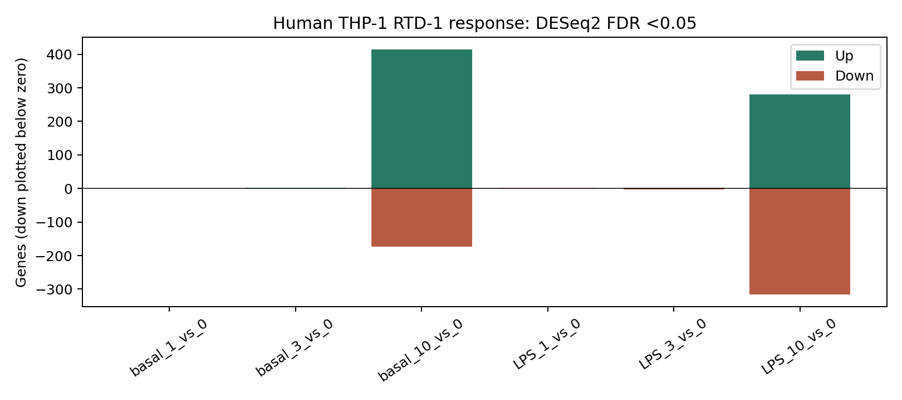
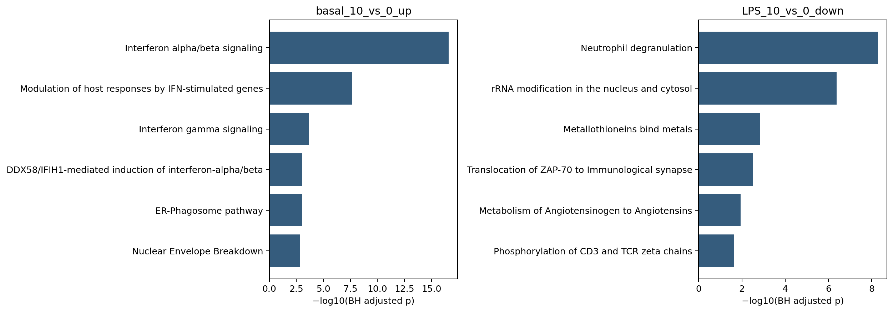
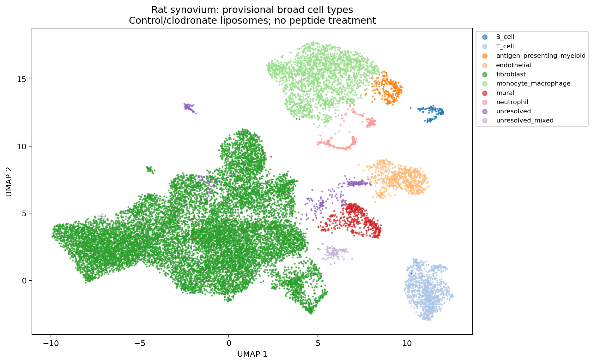

# RTD-1 / MTD project: Specific Objectives 1 and 2

## Scope and available data

Completed public-data preparation, exploratory gene-expression analysis, and pathway analysis. Network integration, peptide target prediction, AI mechanism ranking, and RTD-1 versus MTD comparison are outside the requested scope. The [dataset inventory](../data/dataset_inventory.tsv) records six dataset/assay entries and their limitations. [Source checksums](../data/source_manifest.json) cover downloaded primary inputs.

The three expression resources remain separate: rat arthritis processed tables, human THP-1 bulk RNA-seq, and rat single-cell synovium. GSE278567 is human, not rat. GSE269120 compares control versus clodronate liposomes in inflamed joints, not healthy versus arthritic joints, and includes no peptide exposure.

## Rat 2019 supplementary results

S2 contains 617 published disease-associated genes; S5 contains 258 day-3 genes and S6 contains 107 day-5 genes. Their union is **329 unique genes**, with 36 shared. This does not reconstruct the paper's 340 genes across days 1–5: a day-1 gene-level table is absent from this workbook. Four S5 IDs and one S6 ID are outside S2. These discrepancies are retained in [the audit](../data/processed/rat_2019_audit.json).

The signed fold-change values are preserved verbatim. S5 reports positive Ccl20 and Mmp9 values despite narrative descriptions of suppression; no sign correction or monotonic reversal conclusion was imposed. There are no per-gene adjusted p values or sample-level counts in these three tables. We therefore do not recompute differential expression, manufacture volcano plots, or claim to reproduce the original DESeq2 analysis.

Species-specific Reactome over-representation of S5/S6 used S2 as a **conditional disease-gene background**, excluding out-of-background IDs. Neither day had a pathway with BH FDR <0.05. This restricted test does not reproduce the paper's enrichment against an unavailable assayed transcriptome and does not refute its biological conclusions.

| analysis | input_query | annotated_query_in_background | annotated_background | pathways_tested | significant_FDR_005 |
| --- | --- | --- | --- | --- | --- |
| rat_day3_conditional | 258 | 139 | 354 | 63 | 0 |
| rat_day5_conditional | 107 | 62 | 354 | 63 | 0 |

## Human bulk RNA-seq: GSE278567

24 samples form eight groups (three samples each): 0, 1, 3, or 10 µg/ml RTD-1, with or without LPS, at 20 h. GEO sample descriptions explicitly map count columns to GSM accessions. The original file contains 25,240 genes and fractional Partek E/M estimated counts. We rounded estimated counts to the nearest integer, filtered to ≥10 counts in ≥3 samples, and retained 17,790 genes. This approximation is documented and should be revisited with count-generation details or raw-read reprocessing before confirmatory use. TMM-normalized counts were not used as DESeq2 inputs.

DESeq2 1.52.0 used `~group`, six peptide-versus-vehicle contrasts within LPS strata, and BH FDR 0.05 separately per contrast. Experiment labels alone do not establish matched blocks, so no pairing was assumed. These are unshrunken fold changes, with no extra effect-size cutoff. Independent filtering changes the number of genes eligible for adjusted p values. R package versions are recorded in [sessionInfo](bulk/sessionInfo.txt).

| contrast | tested | adjusted | significant | up | down |
| --- | --- | --- | --- | --- | --- |
| basal_1_vs_0 | 17790 | 17790 | 0 | 0 | 0 |
| basal_3_vs_0 | 17790 | 17790 | 2 | 2 | 0 |
| basal_10_vs_0 | 17790 | 13996 | 587 | 414 | 173 |
| LPS_1_vs_0 | 17790 | 17790 | 1 | 0 | 1 |
| LPS_3_vs_0 | 17790 | 17790 | 5 | 2 | 3 |
| LPS_10_vs_0 | 17790 | 13651 | 595 | 280 | 315 |

These differential-expression counts refer to supplied gene features, retaining separate pseudoautosomal `_PAR_Y` rows. Pathway analysis removes version suffixes and collapses to unique stable Ensembl gene IDs, so foreground/background counts in its audit can be slightly smaller than the DESeq2 feature counts.

PCA separates LPS status on PC1 (73.1% variance) and shows a systematic shift for the third labelled replicate on PC2 (7.4%). This is an unresolved experimental/batch structure: metadata do not confirm a matched block. A sensitivity model `~replicate_label + group` therefore tests adjustment for the candidate block without replacing the primary analysis. The comparison below documents model dependence; pathway results below refer to the primary model only. No samples were removed.

| contrast | primary_FDR_genes | candidate_block_FDR_genes | shared_FDR_genes | shared_same_direction |
| --- | --- | --- | --- | --- |
| basal_1_vs_0 | 0 | 8 | 0 | 0 |
| basal_3_vs_0 | 2 | 40 | 2 | 2 |
| basal_10_vs_0 | 587 | 1411 | 574 | 574 |
| LPS_1_vs_0 | 1 | 5 | 1 | 1 |
| LPS_3_vs_0 | 5 | 44 | 4 | 4 |
| LPS_10_vs_0 | 595 | 1541 | 594 | 594 |

[Primary sample PCA](bulk/sample_pca.pdf) and [candidate-block model details](bulk_sensitivity/methods.txt).

The strongest upregulated pathway association at 10 µg/ml without LPS was **Interferon alpha/beta signaling** (BH adjusted p = 2.52e-17). In the LPS stratum at 10 µg/ml, the strongest downregulated-set association was **Neutrophil degranulation** (BH adjusted p = 5.12e-09). These are gene-set associations. A neutrophil pathway name in THP-1 cells does not indicate neutrophil abundance, and enrichment alone does not establish pathway activation or inhibition.

## Rat single-cell RNA-seq: GSE269120

| sample | input_cells | retained_cells | mitochondrial_features |
| --- | --- | --- | --- |
| GSM8306635 | 9006 | 8751 | 13 |
| GSM8306636 | 10339 | 10283 | 13 |

19,034 cells passed filters: 200–6,000 detected genes, ≤50,000 counts, and <15% mitochondrial counts. Genes detected in ≥3 cells were retained (18,133 genes). Processing used Scanpy 1.11.5, 10,000-count normalization and log1p, 2,000 HVGs selected with sample-aware selection, 40 PCs, an exact 15-neighbor graph over 30 PCs, UMAP, and Leiden resolution 0.6 (seed 0). No condition-removing batch integration was applied.

The 17 clusters were reviewed against canonical marker panels and top expression markers. Provisional broad identities include fibroblasts, endothelial, mural, B, T, monocyte/macrophage, neutrophil, and antigen-presenting myeloid cells. Cluster 7 remains unresolved; cluster 12 has mixed stromal/lymphocyte markers and remains unresolved because residual doublets or ambient RNA could explain the pattern. Clusters 1 and 5 have heat-shock/immediate-early signatures. [Annotation evidence and cautions](singlecell/provisional_annotations.tsv) accompany each cluster; subtype validation remains open.

Cluster-marker pathway enrichment is descriptive: top 50 positive markers with log2FC >0.5 and ≥25% detection, using expressed rat genes as background. Cell-level marker p values do not supply biological replication. There is one sequenced library per condition, so no replicate-based condition differential expression or cell-composition significance tests were performed. This dataset cannot establish RTD-1- or MTD-specific cellular responses. Doublets and ambient RNA were not explicitly corrected.

## Cytokines, proteins, and MTD availability

The 2019 human RA-FLS cytokine assays and 2017 rat arthritis/protease study provide relevant published observations, but no verified machine-readable sample-level cytokine/proteomics matrix was collected from their inspected supplements. The 2021 MTD12813 study and its supplementary PDF were collected; its underlying datasets are available from the corresponding author on reasonable request. No matched MTD transcriptome or peptide-interactor dataset was verified in these resources. No measurements were inferred from figure images, and no author was contacted.

## Statistical and interpretation limits

Reactome release 98 direct Ensembl mappings were used separately for rat and human. No uppercasing-based orthology substitution was used. Tests are one-sided hypergeometric over-representation, pathway size 5–500 after intersecting the assayed background; BH includes all eligible pathways including zero overlaps, separately for each gene list. The [mapping audit](pathways/mapping_audit.tsv) records annotation coverage and excluded IDs. Rat mappings include electronically inferred orthologous pathways, so associations need biological review. Gene-list restriction, incomplete annotation, count rounding, small bulk group sizes, single-cell sampling, and uncorrected technical artifacts limit interpretation. No cross-study or cross-species merging, target ranking, binding inference, or causal mechanism claim was made.

## Primary sources

- [2019 paper](https://doi.org/10.1152/physiolgenomics.00066.2019) and [Figshare supplement](https://doi.org/10.6084/m9.figshare.8855588).
- [Human bulk GEO record](https://www.ncbi.nlm.nih.gov/geo/query/acc.cgi?acc=GSE278567).
- [Rat single-cell GEO record](https://www.ncbi.nlm.nih.gov/geo/query/acc.cgi?acc=GSE269120) and [single-cell paper](https://doi.org/10.1186/s41232-024-00361-2).
- [2017 arthritis/protein study](https://doi.org/10.1371/journal.pone.0187868).
- [MTD12813 study](https://doi.org/10.1038/s41598-021-02619-y).
- [DESeq2 methods](https://bioconductor.org/packages/release/bioc/vignettes/DESeq2/inst/doc/DESeq2.html), [Scanpy workflow](https://scanpy.readthedocs.io/en/stable/tutorials/basics/clustering.html), and [Reactome downloads](https://reactome.org/download-data).
